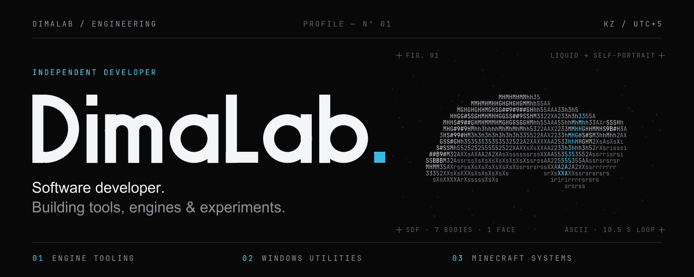
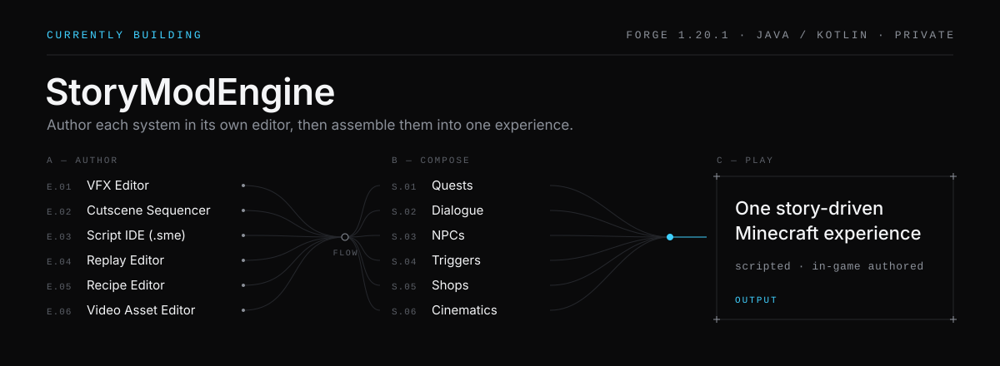
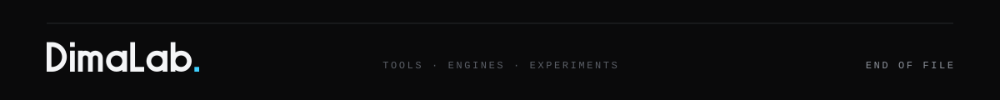

<!-- Hero: assets/src/ascii_hero.py. Card: assets/src/card.py (portrait from avatar_ascii.py). Calendar, streaks, snake: assets/src/contributions.py. Plates, button, footer: assets/src/build.py -->



Software close to the system — taskbars, render pipelines, mod loaders — built with attention to how it feels to use.

<picture>
  <source media="(max-width: 600px)" srcset="https://github.com/LomakoDima/LomakoDima/raw/main/assets/card-mobile.svg">
  
</picture>

<a href="https://dima-s-cinematic-journey-new.vercel.app"></a>

<br>

## 01 — Selected work

| Project | What it does |
| :-- | :-- |
| **[FluentFlow](https://github.com/LomakoDima/FluentFlow)**<br><sub>C# · WPF · .NET 10</sub><br><sub>[RELEASED](https://github.com/LomakoDima/FluentFlow/releases)</sub> | Media controller that lives on the Windows 11 taskbar: a live spectrum visualizer from WASAPI loopback, a native-style volume flyout and a settings window with a live preview. The docking geometry is unit-tested. |
| **[PushLog](https://github.com/LomakoDima/pushlog-bot)**<br><sub>Python · GitHub Actions · Claude API</sub><br><sub>IN USE</sub> | GitHub Action that turns every push into a Telegram devlog post. Claude summarises the commits and a bounded diff, with commit subjects as the fallback. One central action serves all my repositories. |
| **[OculusSMECompat](https://github.com/LomakoDima/OculusSMECompact)**<br><sub>Java · Forge 1.20.1 · Mixin</sub><br><sub>EXPERIMENTAL</sub> | Mixin addon that keeps StoryModEngine's GPU instancing alive under Oculus/Iris shader packs instead of falling back to immediate-mode rendering. |
| **[Lens](https://github.com/LomakoDima/LensMod)**<br><sub>Java · Forge 1.20.1</sub><br><sub>WORKING</sub> | Client-side zoom for Minecraft with smooth animation, scroll-to-zoom and automatic mouse-sensitivity scaling. |
| **[MineGUI](https://github.com/LomakoDima/MineGUI)**<br><sub>Java · Forge 1.21</sub><br><sub>EARLY</sub> | Toolkit for Forge mod screens: box and grid layouts, snap panels, collapsible windows, tooltips and animated widgets. |

<sub>ALSO&nbsp; — &nbsp;[study-buddy-pro](https://github.com/LomakoDima/study-buddy-pro): a Telegram Mini App that turns PDF, DOCX and PPTX lectures into summaries (React, FastAPI) &nbsp;·&nbsp; [History of Kazakhstan trainer](https://history-of-kazakhstan-trainer-new1.vercel.app): an oral-exam trainer with Claude-assisted essay review</sub>

<br>

## 02 — Currently building



**StoryModEngine** is a mod-development engine on Forge 1.20.1. Content is declared, not wired: one `@AutoContent` annotation and the engine infers ids, registries and generated resources. On top of that sit quests, dialogue, NPCs, cutscenes and a `.sme` scripting language, each with its own in-game tooling. The source is private for now.

```text
2026-10-08  script IDE, player model
2026-10-05  replay system + editor
2026-10-01  MP4 video via FFmpeg
2026-09-30  timeline + recipe editor
```

<br>

## 03 — Toolkit

| Area | Tools |
| :-- | :-- |
| **Languages** | Java · Kotlin · C# · Python · TypeScript · GLSL |
| **Desktop & systems** | .NET · WPF · Win32 interop · WASAPI · UI Automation |
| **Game dev & modding** | Minecraft Forge · Mixin · Gradle · glTF / GLB · shaders |
| **Web** | React · Vite · Tailwind CSS · FastAPI · Node.js |
| **Tools & infra** | Git · GitHub Actions · Vercel · SQLite / PostgreSQL · Claude API · Telegram Bot API |

<br>

## 04 — Activity

<picture>
  <source media="(max-width: 600px)" srcset="https://github.com/LomakoDima/LomakoDima/raw/main/assets/activity-mobile.svg">
  
</picture>

<sub>Real daily counts from GitHub's GraphQL API, re-rendered every day by a workflow in this repository. The snake eats the twelve busiest days, then the grid resets. GitHub's own calendar, just below, remains the record.</sub>

<br>

## 05 — Links

[Portfolio](https://dima-s-cinematic-journey-new.vercel.app) &nbsp;·&nbsp; [GitHub](https://github.com/LomakoDima) &nbsp;·&nbsp; [All repositories](https://github.com/LomakoDima?tab=repositories)

<br>


